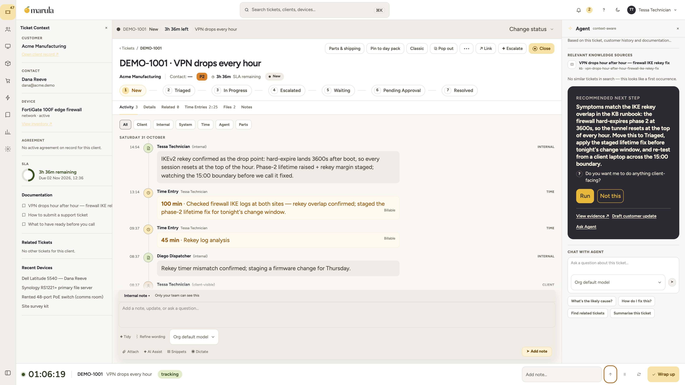
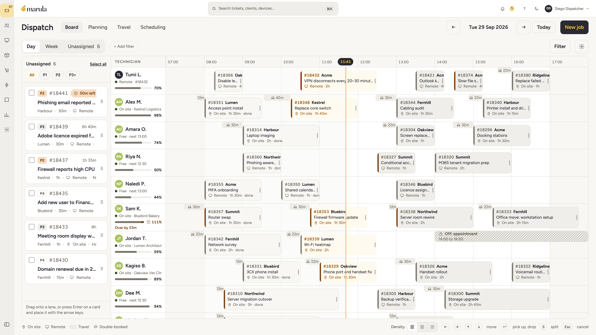

<p align="center">
  <picture>
    <source media="(prefers-color-scheme: dark)" srcset="assets/logo/dark.png">
    <source media="(prefers-color-scheme: light)" srcset="assets/logo/light.png">
    
  </picture>
</p>

<p align="center">
  <a href="LICENSE"></a>
  <a href="packages/sdk/LICENSE"></a>
  <a href="docs/site/LICENSE"></a>
</p>

<h1 align="center">Marula PSA</h1>

<p align="center">
  <strong>A PSA you host yourself.</strong><br>
  Built for MSPs. If your service desk runs on ConnectWise, Autotask, Syncro or
  Atera, this is the one you can read, run and keep — tickets, time, dispatch,
  projects, invoicing, a knowledge base and a client portal, on a PostgreSQL
  database you control.
</p>

<p align="center">
  <a href="https://getmarula.com">Website</a> ·
  <a href="https://getmarula.com/docs">Docs</a> ·
  <a href="https://getmarula.com/changelog">Changelog</a> ·
  <a href="https://github.com/MarulaHQ/marula-core/discussions">Discussions</a> ·
  <a href="https://github.com/MarulaHQ/marula-core/issues">Issues</a> ·
  <a href="CONTRIBUTING.md">Contributing</a>
</p>

<p align="center">
  <picture>
    <source media="(prefers-color-scheme: dark)" srcset="assets/shots/ticket_hero_dark.png">
    <source media="(prefers-color-scheme: light)" srcset="assets/shots/ticket_hero_light.png">
    
  </picture>
</p>

> **Status:** pre-1.0 (0.3.x), built in the open. [`ROADMAP.md`](ROADMAP.md) says what ships today and what is next; [`CHANGELOG.md`](CHANGELOG.md) records what changed in each release.

<!-- TODO(ci): CI badges once the pipelines are public.
 -->

---

## Why we built it

> “I nearly got fired over *time entry.*” — the first line of
> [`MANIFESTO.md`](MANIFESTO.md), by Tumi Lengoasa, who built Marula after
> years of working tickets in a PSA that needed four screens and a handful of
> save buttons to record an hour.

So we built the one we wanted on our own desks. A ticket takes one screen:
notes, timer, conversation and documents live in the same view because they
are the same job. The timer follows you across tickets and rough notes become
a proper time entry. The assistant does the mechanical work (surfacing the
runbook, drafting the note, proposing the fix) and hands it to a person, who
decides. Anything a client can see waits for a human click, always.

> [TODO: one or two sentences on who maintains Marula and what sustains it.
> MSPs will ask “what happens if you disappear?”, and a plain answer up front
> earns trust.]

Marula covers invoicing, quotes, the knowledge base, CSAT surveys and dispatch
scheduling natively, so running a service desk does not mean a stack of add-on
subscriptions beside it.

## Try it

You need Docker. From a checkout:

```bash
git clone https://github.com/MarulaHQ/marula-core && cd marula-core
docker compose -f deploy/docker-compose.yml --env-file deploy/dev.env up -d --build
# workspace UI on http://localhost:3000 · API on :8080 · Scalar docs at :8080/docs
```

`deploy/dev.env` holds the published development secrets, so the stack warns at
every boot. Run it on a machine you own. An install that serves anyone else
generates its own eight secrets: [`deploy/README.md`](deploy/README.md) lists
them and [`docs/install.md`](docs/install.md) walks the installer. Before
installing for real, check that machine against the installer's per-profile
floors — same file, [`docs/install.md`](docs/install.md).

Prefer it hosted? Marula Cloud is the hosted edition. It arrives with the
hosted launch, and [getmarula.com](https://getmarula.com) takes waitlist
sign-ups meanwhile.

Working on the web app? Keep the stack up, free port 3000, and run the UI on
the host with hot reload:

```bash
docker compose -f deploy/docker-compose.yml --env-file deploy/dev.env stop web
pnpm install && pnpm dev                             # Next.js on :3000 against the API on :8080
```

Full installation, configuration and upgrade runbooks live in
[`docs/`](docs/). The generated API reference is served by `core-api` at
`/docs`.

## What a day looks like

<p align="center">
  <picture>
    <source media="(prefers-color-scheme: dark)" srcset="assets/shots/dispatch_dark.png">
    <source media="(prefers-color-scheme: light)" srcset="assets/shots/dispatch_light.png">
    
  </picture>
</p>

- **Technicians** run one timer at a time, write customer-facing and internal
  notes in the same place, and close the gaps in their day in a couple of
  minutes.
- **Dispatchers** see each tech's real capacity on the calendar, catch SLA
  risk before a ticket breaches, and book visits with travel-time estimates.
- **Office managers and owners** check approved hours against retainers and
  project milestones, then issue invoices and credit notes from work that is
  already logged. Clients get a portal to pay and to approve quotes.
- **Sysadmins** host it on standard PostgreSQL and Valkey, set AI and plugin
  permissions per role, and can search an append-only audit trail for any
  change.

## Four things we're picky about

**Renaming a column shouldn't break your SLAs.** Boards can look however your
shop works. Underneath, every status maps to one of four stages: `open`,
`in_progress`, `waiting` or `closed`. SLA timers, billing rules, reports and
automations bind to the stage, not your label. Rename “Waiting on vendor” to
whatever you like and nothing downstream notices.

**Worked hours should match billed hours.** One active timer per tech. A
missing-time check each evening. Approval before any invoice goes
out. When hours go missing between the timesheet and the invoice, you can see
where.

**The assistant proposes, a person decides.** When the AI assistant suggests a
change to a ticket or a record, it waits as *proposed, awaiting approval*.
Anything the client can see, or anything that leaves the system, needs a human
click. Skills are versioned manifests rather than prompt spaghetti, guardrail
rules run before every tool call, and the audit log records whether a person
or an assistant made each change. “Who changed this?” is one search. There is
also an MCP server, so Claude, DeepSeek or your own scripts can work inside
the PSA under the same rules as everyone else. Details:
[`docs/site/`](docs/site/index.md), [`docs/instant-first.md`](docs/instant-first.md),
[`docs/10-agent-platform.md`](docs/10-agent-platform.md).

**Fast, and we test for it.** The ticket list stays under 150 ms at p95 with
50k tickets, and CI fails the build if it slips. A committed write reaches
other viewers over the live stream in under 100 ms. Edits save as you type,
and Ctrl/Cmd+Z steps back through changes the server has already recorded.

## What's inside

| Module | What it does |
|---|---|
| **Ticketing** | Boards, custom workflows bound to the four stages, calendar-aware SLA timers, automations, structured notes, canned reply snippets, CSAT surveys on resolution, email in and out with threading |
| **Time** | One active timer, segment tracking, missing-time audits, approval queues, and cost/bill rates |
| **Dispatch** | Capacity board, unassigned queue, conflict detection, travel estimates, planning across service and project work |
| **Projects** | Phases, tasks, dependencies, templates, milestone billing |
| **Commercial** | Contracts, quotes, catalog, inventory, pipeline, native invoicing with payments and dunning |
| **Knowledge base** | Articles, categories, full-text search, client-facing visibility |
| **Client portal** | Tickets, invoices and payment, quote approval, KB self-service |
| **Agent harness** | Versioned skills, layered rules, an MCP server over the domain API, a complete audit trail |

Integrations are connectors: ordinary web apps built on
[`@marula-core/sdk`](packages/sdk/) that receive signed webhooks. NinjaOne,
Hudu, Microsoft 365, UniFi, 3CX, Slack and Teams, Rewst, and the QuickBooks
and Xero exports ship in the core, with a merge queue that keeps the same
device or contact from forking into duplicates. Connector authors usually do
not need this repo at all — the SDK and a webhook subscription are the whole
contract.

## How it fits together

```
web (Next.js) ──► core-api (Rust/Axum) ──► PostgreSQL (RLS · FTS · pgvector)
        │                │   outbox event trail ──► SSE live stream on core-api
        │                ├── worker (jobs: email · SLA · sync · AI hooks)
        │                └── plugin-host (Extism WASM + HTTP connectors)
        └── @marula-core/sdk clients · MCP server · signed webhooks
```

`core-api` is the only thing that writes to the database. Every change emits a
versioned domain event, and REST, the SSE stream, webhooks, plugins and MCP
are all views onto that one contract.

## Where it's rough

- **Install is Docker Compose or nothing, for now.** The `marula` installer
  and the build CLI are still in progress, so `deploy/docker-compose.yml` is
  the only supported path. It works. It just isn't done.
- **The UI is mid-refinement.** We are in a visual refinement pass right now,
  so some pages may have elements out of place or layouts that are not
  responsive yet. Everything is usable, and it gets tidier week by week.
- **You're installing 0.x.** Minor releases can carry breaking changes, each
  one flagged and documented. Read the release notes before you upgrade, and
  [`docs/upgrade-compatibility-policy.md`](docs/upgrade-compatibility-policy.md)
  is the contract.
- **The connector catalog is small.** The standard set ships in the core:
  NinjaOne, Hudu, Microsoft 365, UniFi, 3CX, Slack and Teams, Rewst,
  QuickBooks and Xero. The SDK is Apache-2.0, so if your stack needs a
  connector we don't have, build it, tell us about it, and share it.

## Documentation

| | |
|---|---|
| Install and self-host | [`docs/install.md`](docs/install.md) covers the installer, the plan and what stays manual. [`deploy/README.md`](deploy/README.md) covers the compose stacks, secrets and runbooks |
| Task guides | [`docs/site/index.md`](docs/site/index.md), for owners, admins, technicians and operators |
| Upgrades | [`docs/upgrade-compatibility-policy.md`](docs/upgrade-compatibility-policy.md): support windows, breaking-change rules, what's guaranteed |
| Interaction contract | [`docs/instant-first.md`](docs/instant-first.md): autosave, undo, agent approval, the core's read models |
| API reference | Generated from OpenAPI (`utoipa`), served as Scalar UI by `core-api` at `/docs` |
| SDK and plugins | [`packages/sdk/`](packages/sdk/) is the typed client. [`packages/plugin-kit/`](packages/plugin-kit/) is the PDK. [`plugins/connectors/`](plugins/connectors/) has the reference implementations |
| Architecture decisions | [`docs/adr/`](docs/adr/) |
| Workflows | [`docs/reference/workflow-node-catalogue.md`](docs/reference/workflow-node-catalogue.md) lists every node type by tier. The foundation is [ADR 0016](docs/adr/0016-workflow-builder-foundation.md) |
| Tech stack | [`docs/tech-stack.md`](docs/tech-stack.md): every layer and the versions the manifests pin |
| Visual identity | [`docs/theme.md`](docs/theme.md): the tokens and motion rules the UI is built from |

## Roadmap

Work moves through stages: foundation, daily driver, commercial engine, GA
hardening, ecosystem. [`ROADMAP.md`](ROADMAP.md) keeps three columns
(shipped, in flight, later) and never dates work nobody owns.
[`CHANGELOG.md`](CHANGELOG.md) records what each release changed.

## Contributing

PRs are welcome. Changes land trunk-based and squash-merged, with conventional
commit subjects and a DCO sign-off. `crates/core-domain` and anything touching
authz, RLS or payments needs two approvals. Start with
[`CONTRIBUTING.md`](CONTRIBUTING.md), and open an RFC in
[`docs/rfc/`](docs/rfc/) before anything significant.

Questions and ideas live in
[Discussions](https://github.com/MarulaHQ/marula-core/discussions); bugs go to
[Issues](https://github.com/MarulaHQ/marula-core/issues). If you are writing a
connector, use the SDK and read the NinjaOne and Hudu connectors — you likely
don't need this repo at all.

## Security

Report vulnerabilities privately through [`SECURITY.md`](SECURITY.md). Please
don't open a public issue for a security report.

## License

- **AGPL-3.0** covers everything not listed below: the Rust workspace
  (`crates/`), both apps (`apps/`), the desktop and mobile shells
  (`desktop/`, `native/`), the installer (`installer/`), and the UI packages
  (`packages/ui/`, `packages/ui-native/`, `packages/layout/`)
- **Apache-2.0** covers the SDK, plugin kit, plugins and connectors
  ([`packages/sdk/LICENSE`](packages/sdk/LICENSE))
- **CC BY 4.0** covers the documentation in `docs/site/`, with attribution
  ([`docs/site/NOTICE`](docs/site/NOTICE))
- Third-party components are listed in
  [`ACKNOWLEDGMENTS.md`](ACKNOWLEDGMENTS.md): fonts (OFL), embedded PostgreSQL
  and pgvector, the full npm inventory, vendored tooling

In plain language: running Marula unmodified for your own shop carries no
extra obligations, and modifying it or running it for others asks you to share
the source you changed on the same terms. Read the license, or get advice if
the edge cases matter. (Worth a second look by someone qualified before this
line is final.)

The Marula name, wordmark and fruit mark are trademarks:
[`TRADEMARK.md`](TRADEMARK.md). None of these licences grants trademark
rights.

---

## Repository layout

<details>
<summary>Module map</summary>

```
crates/
├── core-api/         # Axum HTTP API: the only database writer
├── core-domain/      # entities, policies, domain services (pure, heavily tested)
├── core-db/          # SQLx queries + migrations
├── core-events/      # outbox, versioned event envelope, live-stream publisher
├── core-billing/     # contracts, recurring billing rules, invoice runs
├── core-projects/    # phases, tasks, dependencies, templates, milestone billing
├── core-kb/          # knowledge base domain rules
├── core-documents/   # document versions and their permissions
├── core-mail/        # inbound and outbound email
├── core-reports/     # reporting field catalog and query compiler
├── core-routing/     # distance and duration provider seam (maps)
├── core-decision/    # the provider-general decision edge
├── core-store/       # object-store edge
├── core-otel/        # the shared OpenTelemetry baseline
├── worker/           # Postgres-backed job queue + job definitions
├── plugin-host/      # Extism WASM runtime + connector proxy
├── mcp-server/       # MCP protocol adapter over the public API
├── perf-harness/     # the measurement harness behind docs/perf.md
└── marula-core-cli/  # `marula`: install, migrate, upgrade, seed, operator tasks
apps/
├── web/              # Next.js app (workspace UI + client portal)
└── installer/        # the installer wizard UI
packages/
├── sdk/              # @marula-core/sdk: typed client generated from OpenAPI (Apache-2.0)
├── ui/               # Marula design system: tokens + components (AGPL-3.0)
├── ui-native/        # the same tokens for the mobile surface (AGPL-3.0)
├── layout/           # multi-pane layout engine (AGPL-3.0)
└── plugin-kit/       # plugin PDK: ABI bindings + build and sign tooling (Apache-2.0)
plugins/              # first-party extensions (Apache-2.0): connectors/ (HTTP) + wasm/
deploy/               # compose stacks, Helm chart, TLS edge, backup, runbooks
desktop/              # Tauri 2 shell for macOS
native/               # the mobile app (React Native / Expo)
installer/            # the `marula install` crate behind the wizard
e2e/                  # Playwright flows and the stack harness they run against
docs/                 # published docs site, engineering notes, ADRs, RFCs
fixtures/             # upgrade fixtures, event fixtures and the pinned OpenAPI documents
release-keys/         # the release signing keys a download is verified against
scripts/              # dev, CI and verification tooling
.github/              # CI, templates, actions
```

Most modules have a README that says what the module is for *and what it
isn't for*. Read [`crates/core-api/README.md`](crates/core-api/README.md) and
[`packages/ui/README.md`](packages/ui/README.md) first.
</details>

## Thanks

Marula stands on Rust, Axum, SQLx, PostgreSQL, Next.js, Tailwind CSS,
shadcn/ui, Extism and faster-whisper. Thank you to the people who build and
maintain them.
