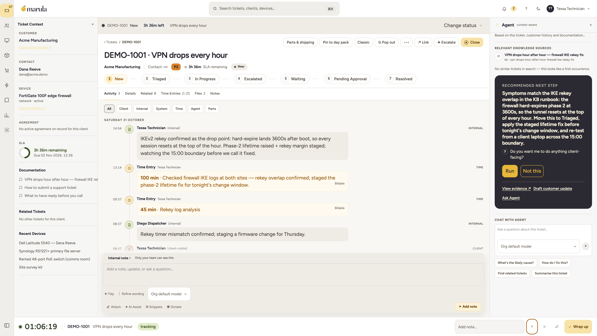

<p align="center">
  <picture>
    <source media="(prefers-color-scheme: dark)" srcset="assets/logo/dark.png">
    <source media="(prefers-color-scheme: light)" srcset="assets/logo/light.png">
    
  </picture>
</p>

<h1 align="center">Marula PSA</h1>

<p align="center">
  A PSA you host yourself: tickets, time, dispatch, projects, invoicing, a
  knowledge base and a client portal, on a PostgreSQL database you control.
</p>

## Install

The release publishes one archive and one checksum list per platform. Download
both from the [Releases page](https://github.com/MarulaHQ/marula-core/releases),
check the archive, unpack it, and run the installer inside. You need Docker with
Compose 2.24 or newer, and a machine that meets the installer's floors: four
cores, 8 GB of memory and 40 GB of free disk for the default shape, or 30 GB on
`all-in-one`. The installer checks those and names any it misses.

On Linux x86_64 (use the `linux-arm64` files on arm64):

```sh
# Check the archive you downloaded, then unpack it and run the installer:
sha256sum -c SHA256SUMS-linux-x64
tar -xzf marula-<version>-linux-x64.tar.gz
cd marula-<version>-linux-x64
./install.sh
# On a server, print the plan and then apply it:
#   ./install.sh --dir /srv/marula --images registry
#   ./install.sh --dir /srv/marula --images registry --apply
```

On macOS arm64:

```sh
shasum -a 256 -c SHA256SUMS-macos-arm64
tar -xzf marula-<version>-macos-arm64.tar.gz
cd marula-<version>-macos-arm64
./install.sh
```

The checksum proves the download arrived intact. The `.sig` beside the list is
the release signature, and [`docs/release.md`](docs/release.md) shows that
check. `./install.sh` then re-checks the unpacked tree against its own
`SHA256SUMS`.

<!-- coderabbit-ai-generated:v1 -->

<!-- coderabbit-ai-generated-section:v1:6280aba4bd4687e82453fbbf4ad366e995ede4f19727abcb4c56bf37c1cac35e -->

`./install.sh` with no arguments opens the loopback browser wizard, which plans
and applies on its own and installs into `~/marula`. Release bundle users must
select **Pull the published images** in the wizard or pass `--images registry`
on the command line. With arguments it forwards them
to `./marula install`: without `--ui` that prints the plan and writes nothing,
and `--apply` writes the environment file and starts the stack. `--images
registry` pulls the four published images (`marula-core-api`, `marula-worker`,
`marula-migrate`, `marula-web`) by digest from the bundle's `release.json`, so no
digest is typed by hand. No account is needed: Docker Hardened Images are free
and pull without a login, and if a pull ever asks for credentials, `docker login
dhi.io` with a free Docker account is the fallback. [Installing on a
machine](docs/install.md) covers the eight secrets, the shapes, the optional
embedding model, upgrades and backups.


<!-- /coderabbit-ai-generated:v1 -->
## What you get

| URL | What it is |
|---|---|
| http://localhost:3000 | The workspace: tickets, dispatch, projects, billing |
| http://localhost:3000/portal | The client portal, as a client sees it |
| http://localhost:8080 | The API, the only writer to the database |
| http://localhost:8080/docs | The API reference, generated from the OpenAPI document |

Open `/login` and switch to **Create org** to make your organisation and the
first owner account.

<p align="center">
  <picture>
    <source media="(prefers-color-scheme: dark)" srcset="assets/shots/ticket_hero_dark.png">
    <source media="(prefers-color-scheme: light)" srcset="assets/shots/ticket_hero_light.png">
    
  </picture>
</p>

## Working on the code

Changing Marula starts with a clone and one Compose command:

```sh
git clone https://github.com/MarulaHQ/marula-core && cd marula-core
docker compose -f deploy/docker-compose.yml --env-file deploy/dev.env up -d --build
```

The first build compiles the Rust workspace and the Next.js bundle, so it takes
minutes. `deploy/dev.env` holds published development secrets; the stack warns
at every boot while they are in use, and it belongs on a machine you own.

[Working on the code](docs/install-from-source.md) has the toolchains, hot
reload for the web app, the end-to-end stack, and the gate commands.

## What's inside

| Module | What it does |
|---|---|
| **Ticketing** | Boards, workflows bound to four stages, SLA timers, automations, CSAT surveys, email in and out with threading |
| **Time** | One active timer, segment tracking, missing-time audits, approval queues, and separate cost and bill rates |
| **Dispatch** | Capacity board, unassigned queue, conflict detection, travel estimates |
| **Projects** | Phases, tasks, dependencies, templates, milestone billing |
| **Commercial** | Contracts, quotes, catalog, inventory, pipeline, invoicing with payments and dunning |
| **Knowledge base** | Articles, categories, full-text search, client-facing visibility |
| **Client portal** | Tickets, invoices and payment, quote approval, KB self-service |
| **Agent harness** | Versioned skills, layered rules, an MCP server over the domain API, a full audit trail |

Connectors are ordinary web apps built on
[`@marula-core/sdk`](packages/sdk/) that receive signed webhooks. NinjaOne,
Hudu, Microsoft 365, UniFi, 3CX, Slack and Teams, Rewst, and the QuickBooks and
Xero exports ship in the core.

## Where to read next

- [Installing on a machine](docs/install.md): prerequisites, the plan, the
  eight secrets, shapes, profiles, upgrades, backup and restore.
- [Working on the code](docs/install-from-source.md): the contributor path, the
  pooler, the end-to-end stack and the gates.
- [Deploy](deploy/README.md): the compose stacks, every image and secret, the
  profiles, and the operator runbooks.
- [Contributing](CONTRIBUTING.md): the two-command dev loop, review rules and
  sign-off.

The longer guides live in [`docs/site/`](docs/site/index.md), for owners,
admins, technicians and operators. [`CHANGELOG.md`](CHANGELOG.md) records each
release, [`ROADMAP.md`](ROADMAP.md) says what is next, and the API reference is
served by `core-api` at `/docs`.

Report vulnerabilities privately through [`SECURITY.md`](SECURITY.md), not in a
public issue.

Marula is pre-1.0, so a minor release can carry a breaking change.
[`docs/upgrade-compatibility-policy.md`](docs/upgrade-compatibility-policy.md)
says what is guaranteed and for how long.

## License

- **AGPL-3.0** covers everything not listed below: the Rust workspace
  (`crates/`), both apps (`apps/`), the desktop and mobile shells (`desktop/`,
  `native/`), the installer (`installer/`), and the UI packages
  (`packages/ui/`, `packages/ui-native/`, `packages/layout/`)
- **Apache-2.0** covers the SDK, plugin kit, plugins and connectors
  ([`packages/sdk/LICENSE`](packages/sdk/LICENSE))
- **CC BY 4.0** covers the documentation in `docs/site/`, with attribution
  ([`docs/site/NOTICE`](docs/site/NOTICE))
- **Brand assets are not open source.** The logo, wordmark, product mockups,
  screenshots and marketing artwork are © Marula, all rights reserved, and are
  not licensed under any of the licences above. [`TRADEMARK.md`](TRADEMARK.md)
  covers their use as marks.
- Third-party components are listed in
  [`ACKNOWLEDGMENTS.md`](ACKNOWLEDGMENTS.md).

<!-- coderabbit-ai-generated:v1 -->

<!-- coderabbit-ai-generated-section:v1:529d6071eded3df62cd259623eb288d3e2634faf0128a3d51200af258875fc62 -->

Under the AGPL, running an unmodified Marula for your own shop, or for clients,
carries no source-sharing obligation. Two triggers add one. If you modify
Marula and let people use that modified version over a network, section 13
requires you to offer those users the modified source. Conveying either modified
or unmodified copies brings the AGPL's distribution terms with it, including
applicable source requirements. Read the licence, or get advice if the edge
cases matter. The Marula name, wordmark and fruit mark are trademarks, and none
of these licences grants trademark rights.


<!-- /coderabbit-ai-generated:v1 -->